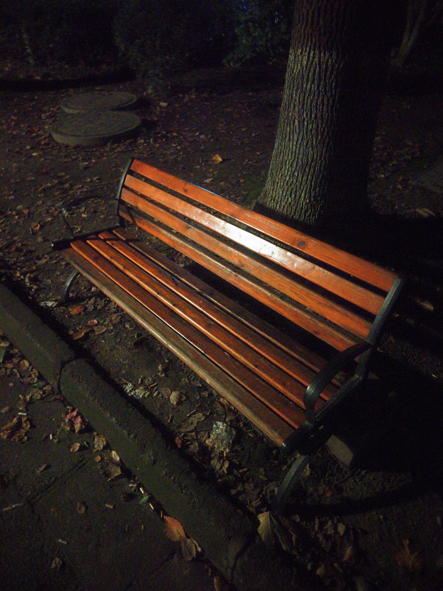
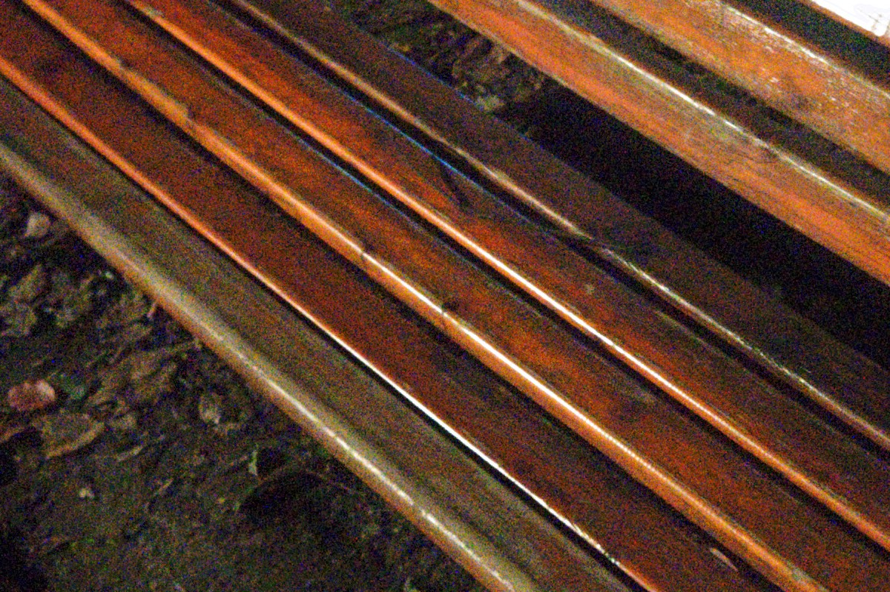
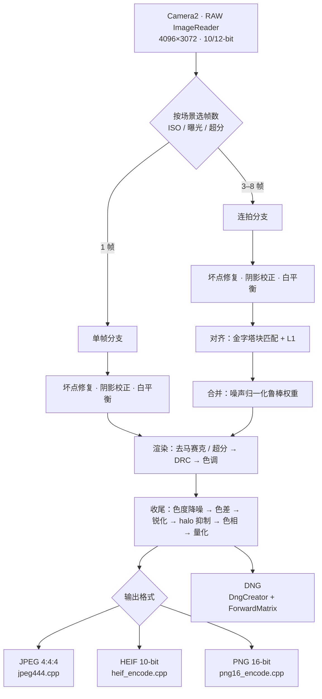
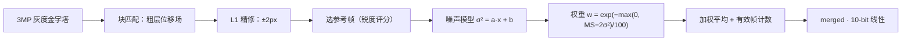
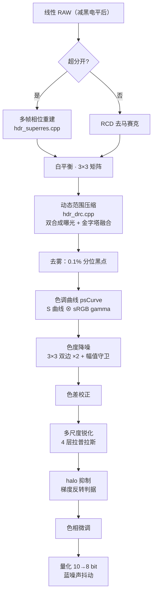

# Camera — 一个自己写 RAW 管线的 Android 相机

> 不用 CameraX 的 Imaging，也不依赖厂商 ISP。从 Bayer RAW 开始，自己做对齐、合并、去马赛克、色调、编码，一直到落盘。
> A from-scratch RAW camera pipeline for Android. Bayer in, JPEG/HEIF/PNG out — align, merge, demosaic, tone-map and encode all written by hand in Kotlin + C++.

**关键词 / Keywords**：`android` `camera2` `raw` `dng` `hdr` `burst-photography` `computational-photography` `image-processing` `demosaic` `super-resolution` `exposure-fusion` `tone-mapping` `jpeg-encoder` `ndk` `cpp` `kotlin` `no-ml` `handheld`

---

## 效果

| 夜景（手持，全像素 RAW 管线输出） | 100% 裁切：木条与树皮 |
|---|---|
|  |  |

> 这一张是刻意选的**难场景**：夜间路灯下，画面均亮度只有 34/255。木条的边缘、树皮的纹理、地面的落叶都还在——这是多帧合并 + 全程 10-bit 的直接结果。

---

## 为什么写这个

手机原厂相机的成像基本被厂商 ISP 黑箱化：你能拿到 JPEG，但拿不到它怎么来的。这个项目把中间每一步都摊开——**每一行都是可读、可调、可验证的**，而不是"调个参数看看效果"。

代价是性能。所以这个项目里另一个同等重要的主题是：**把每个慢的地方量出来，再决定怎么优化**。下面所有性能数字都是实测的，来源在代码注释里。

## 功能

**拍摄**
- 全像素 RAW 连拍（3~8 帧，按 ISO / 曝光时长 / 是否超分自动选择）
- 单帧 RAW 与多帧 HDR 两种模式
- 输出 DNG（含厂商 ForwardMatrix）+ 自行解码的 JPEG
- 点击对焦、AE 锁定

**输出格式**
- JPEG 4:4:4（**自研编码器**，非 libjpeg）
- HEIF 10-bit
- PNG 16-bit

**成像处理**
- 坏点修复（同色邻居中值判据）
- 镜头阴影校正（ISP shading map + 多项式拟合）
- 白平衡（DNG AsShotNeutral + 可选 log-chroma 重估）
- 去马赛克：RCD（Ratio Corrected Demosaicing）或双线性
- 多帧对齐：由粗到细的金字塔块匹配 + L1 精对齐
- 多帧合并：噪声归一化的鲁棒权重（剔除运动 / 鬼影）
- 多帧超分（亚像素相位重建，绕过去马赛克）
- 色度降噪（含"幅值守卫"防色块注入）
- 动态范围压缩：**灰度双合成曝光 + 拉普拉斯金字塔融合**
- 去雾（0.1% 分位定黑点，只压 7% 白点以下）
- 局部影调 + 多尺度锐化 + **halo 抑制**（Polyblur 闭式解）
- 色差校正、色相微调
- 全程 10-bit，**只在最后量化一次**；量化用蓝噪声抖动

**标定**
- 色卡自动检测与 CCM 求解
- 三层颜色链：GLSL 实时预览 / 3D LUT / 矩阵近似（按 API 与性能降级）
- 暗部中性化、滤镜系统

---

## 处理管线

### 总览



### 连拍分支：对齐与合并



> 权重里减掉 `2σ²` 是关键：一块**平坦但噪声大**的区域，MS 天然就大，但那是噪声不是运动。不减这一项，暗部会被当成"有运动"而只用 1~2 帧，噪声压不下去；减掉之后同样场景能用到 4.8/5 帧。代价是阈值要准，否则真运动会漏判。

### 渲染与收尾



---

## 技术渊源：用了谷歌的哪些东西

完整的文献映射（21 篇，含"为什么不用"）见 **[docs/references.md](docs/references.md)**。这里只列实际写进代码的部分。

### 骨架：HDR+ (SIGGRAPH Asia 2016)

整个项目是照着这篇的 13 步管线搭的，逐步对应到代码：

| 论文步骤 | 本项目文件 |
|---|---|
| 黑电平 / 阴影校正 / 白平衡 | `OpticsCorrector.kt` |
| 去马赛克 | `hdr_render.cpp`（RCD） |
| 色度降噪 | `hdr_finish.cpp` |
| 色彩矩阵 | `hdr_render.cpp` |
| **动态范围压缩** | **`hdr_drc.cpp`** |
| 去雾 | `hdr_render.cpp` |
| 全局色调 | `hdr_common.h` |
| 色差校正 | `hdr_finish.cpp` |
| 锐化 | `hdr_finish.cpp` |
| 色相微调 | `hdr_finish.cpp` |
| 抖动 | `hdr_finish.cpp` |

### 为什么是"曝光融合"而不是"增益图"

论文原话：

> we instead boost shadows, **preserving local contrast** while judiciously sacrificing global contrast

具体做法：从 HDR 中间图派生**两个合成曝光**（短/长），**只在灰度上**做拉普拉斯金字塔融合，权重是一条固定的亮度 LUT，融合完用**色度比值**回填颜色。

**先进性在哪**：绝大多数手机管线用"低分辨率增益图乘法"做动态范围压缩。乘性增益只改亮度标量，暗部细节全靠后面的曲线和锐化去捞；而金字塔融合在每一层都挑"曝光最好的那张"的细节，局部对比是**被显式保住**的。

**实测反证**：我一度把融合结果压到 1/8 分辨率当增益图用（注释里还写着"局部影调的增益本来就是低频的"）。A/B 提升到 1/2 分辨率后，暗部高频占比从 0.0304 变成 0.0307（比值 1.01），渲染却从 529ms 涨到 946ms——**这个方向不是瓶颈**，那行注释的结论对、理由是错的。

### 对齐与超分

- **对齐**：HDR+ 与其补充材料（最细层用暴力 L1 搜索）。`hdr_align.cpp`
- **超分**：Handheld Multi-Frame Super-Resolution (SIGGRAPH 2019)。核心是**不先合并再插值，而是把多帧的亚像素相位直接当采样点重建**，从而绕过去马赛克。`hdr_superres.cpp`

### 失效模式：Night Sight (SIGGRAPH Asia 2019)

这篇对我影响最大的不是算法，是**失效清单**。三条直接改了代码：

1. 极低光下 AWB 失效 → 优先用 DNG `AsShotNeutral`，不再二次估计
2. 局部影调会连噪声一起放大 → 加了 `darkBoost` 限幅与"幅值守卫"
3. 帧数该按信噪比需求定 → `chooseBurstCount` 按 ISO 分档，并用"总采集 ≤ 0.9s"做上限（手持抖动在 1 秒量级开始累积）

### halo 抑制：Polyblur (2021)

只采用了它的 halo 部分（`haloGuard`，锐化之后），逐像素闭式解：

```
M(x) = −∇v(x)·∇v̄(x)        // 梯度反转量
z(x) = M / (|∇v|² + M)      // 退回原图的权重
out  = z·v + (1−z)·v̄
```

12MP 上 **26~30ms**。它给出的是"过锐"的**数学判据**，不是阈值或启发式：梯度方向反转了就按比例退回，没反转的地方完全不动。这比"降低锐化强度"精确得多。

**没有采用**它的多项式反卷积本体——那部分依赖**全局**各向同性高斯模型，而我们的模糊是空间可变的；且它用"全图最大梯度"估 σ，户外会被天空边缘带偏。

### 为什么用谷歌的算法

不是因为它有名，而是三个具体理由：

1. **它们是少数把商业系统完整写出来的文献。** 学术论文常只写算法不写系统，相机行业则相反；HDR+ 把 13 步连参数一起列了。
2. **约束相同。** 手机、手持、有限算力、出 JPEG——不是刷分，是在 4W 的手机上 1 秒出片。
3. **它们会写失败模式。** Night Sight 专有一节讲失效场景，补充材料里有"结果差的那几张"。对我们跑真实场景的项目，失效清单比正面结果有用。

---

## 技术细节

### 1. 全程 10-bit，只量化一次

大多数管线在每个阶段结束都回落到 8-bit。这里把 10-bit 保到最后的量化步骤。依据：一条 6..255 的渐变，本该用 250 级，若中途量化只剩 145 级，最大跳变 3 码。

### 2. 自研 JPEG 4:4:4 编码器

libjpeg 默认 4:2:0 会丢一半色度。为保住 4:4:4，自己写了编码器：分离式 DCT + Annex K 霍夫曼表 + RST 分界，12MP q95 **118 ms**（同算法的 Kotlin 版 1083 ms）。

**为什么搬 native**：瓶颈是 `fdct`——朴素行列分离 DCT 每块 1024 次乘加，59 万块 ≈ 6 亿次。kotlinc 不向量化，实测约 10 周期/次乘加；`-O3` 展开成 4 路 `fmla` 后降到 118ms。

顺带排除了两个"看起来像元凶"的项（改了都没有可测收益）：每块 `IntArray(64)` 分配、`writeBits` 逐比特循环。

### 3. 性能

| 阶段 | 耗时 | 说明 |
|---|---|---|
| 打开相机 + AE/AF 收敛 | 1.30 s | 相机打开与 3A |
| 8 帧 RAW 采集 | 0.24 s | 33ms/帧 |
| 对齐 + 合并 | 0.80 s | 含选参考帧 |
| 渲染（去马赛克→DRC→色调） | 0.60 s | |
| 收尾 | 0.99 s | 色度降噪 404 / 色相 187 / 锐化 185 / 影调 125 / 量化 50 |
| JPEG 编码 | 0.11 s | |
| **端到端** | **≈ 4.7 s** | 12MP / 8 帧 / q95 |

优化过程里最大的两项都不是"算法"：

- **读一帧 RAW 从 200ms 降到 15ms**：原来用逐像素 `getShort(x*pixelStride)`，改成 `asShortBuffer().get()` 一次拷。8 帧省了 3.1 秒。
- **坏点修复从 340ms 降到 17ms**：搬到 native。

一个踩坑记录：原以为"连拍开始→第 1 帧要等 1.5 秒"是 HAL 重配管线，实际是 **ImageReader 背压**——读得慢导致 4 个缓冲填满，管线被卡住。改掉读取方式后这段变成 23ms。

### 4. 关于"量对指标"

这一段是失败记录，写出来是因为它影响过判断：

用 `局部标准差/局部均值` 比较 HDR 与单帧的暗部细节，得到"HDR 只有单帧的 0.5 倍"的结论。但这个指标把**提亮本身**也算成了模糊——把暗部乘 2 倍，`std/mean` 就会掉一半，哪怕细节一点没丢。后来改用频谱分带（不受亮度影响）才发现：**HDR 整幅高频其实比单帧高 1.4~2.2 倍**，只有暗部 3~10px 尺度是真的低。

---

## 构建

```bash
# 1. 先编 native（Gradle 只负责打包 .so）
bash app/src/main/cpp/build_native.sh

# 2. 再编 APK
./gradlew assembleDebug
```

脚本会自动探测 NDK：`$NDK` → `$ANDROID_NDK_HOME` → 常见 SDK 位置。

**环境**：compileSdk 34 / minSdk 28 / arm64-v8a + armeabi-v7a

依赖只有 CameraX、Kotlin 协程、Glide。**没有 TensorFlow / NNAPI / 任何 ML 运行时**——所有算法都是手写的。

## 已知限制

- **主要在荣耀 Magic6 Pro 上验证**。其他机型的 HAL 行为（尤其连拍流、3A 状态上报）可能不同。
- **HDR 的暗部细节目前不如单帧 RAW**。实测整幅高频比单帧高 1.4~2.2 倍，但暗部 3~10px 尺度只有 0.5 倍。已排除融合权重与 DRC 分辨率，怀疑在色调管线，待继续定位。
- **"相机常开"未完成**。实测该 HAL 在长曝光连拍后会停止输出，换 session 也不行，需要重建 device。代码在 `RawCaptureController` 的 `persistent` 分支，默认关闭。
- 户外高对比场景 `drcK` 曾到 4.0 导致整体偏亮，已加亮度上限约束，待更多样张验证。
- 没有防抖、没有人像模式、没有视频。

## 参考

完整文献映射（21 篇，含未采用的原因）见 **[docs/references.md](docs/references.md)**。

## License

MIT（见 `LICENSE`）。
